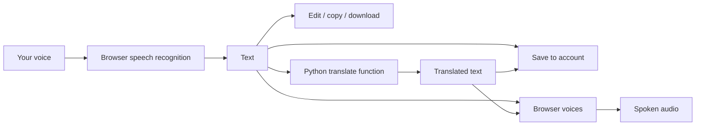

# Text2Talk

**Your Voice. Your Words. Your World.**

Text2Talk is a web app that turns speech into text, turns text into speech, and translates between languages. You can talk and watch your words appear, hear any text read aloud, translate what you say as you say it, and keep everything you save in a private account.

**Live site:** https://text2talk-final.vercel.app

---

## What you can do

| Tool | In one line |
|---|---|
| **Speech-to-Text** | Speak and see your words appear as text. |
| **Text-to-Speech** | Type or paste text and hear it read aloud. |
| **Translate** | Translate text between 18 languages. |
| **Live Translation** | Speak in one language and read the translation phrase by phrase while you talk. |
| **Listen to File** | Drop in a document to hear it read aloud, or an audio file to play it. |
| **History** | Find, replay, rename, favorite, and download everything you saved. |

## What it is built with, and why

### Screens and design
| Technology | What it is used for |
|---|---|
| **React** | Builds the screens and keeps them updating live as you speak, type, and translate. |
| **Vite** | Packages the app so it loads quickly. |
| **Tailwind CSS** | Styles the pages: colors, spacing, and layouts that adapt to phones, tablets, and computers. |
| **React Router** | Moves between pages (home, sign-in, dashboard, tools) without reloading, and keeps private pages behind sign-in. |
| **React Hook Form and Zod** | Run the sign-up and sign-in forms and check them (valid email, strong password, matching passwords). |
| **Lucide** | The icons. |

### Speech
| Technology | What it is used for |
|---|---|
| **Web Speech API (recognition)** | Built into Chrome, Edge, and Safari. Turns your spoken words into text for Speech-to-Text and Live Translation. |
| **Speech Synthesis API** | Built into the browser. Reads text aloud with your device's voices in Text-to-Speech, Translate, Listen to File, and History. |

### Accounts and saved data
| Technology | What it is used for |
|---|---|
| **Supabase Auth** | Handles sign-up, email verification, sign-in, password reset, and sessions. It also hashes and protects passwords. |
| **Supabase PostgreSQL** | The database that stores profiles, saved transcripts, audio items, and contact messages. |
| **Row Level Security** | Database rules that let each person see and change only their own records. |
| **Supabase Storage** | Private storage for the audio files you save. |

### Server and hosting
| Technology | What it is used for |
|---|---|
| **Python serverless functions** | Two small programs that run on the server: one translates text, and the other checks and stores contact messages. |
| **MyMemory translation service** | The outside service that does the actual translation work. |
| **Python SHA-256 hashing** | Turns visitors' IP addresses into scrambled codes so the contact form can limit spam without keeping the real address. |
| **Vercel** | Hosts the site over HTTPS, runs the Python functions, and adds security headers. |

### Files
| Technology | What it is used for |
|---|---|
| **docx** | Creates Word (.docx) downloads. |
| **jsPDF** | Creates PDF downloads. |
| **mammoth** | Reads the text inside Word files you drop into Listen to File. |
| **Browser drag-and-drop and file access** | Lets Listen to File accept a dropped file and read it on your device without uploading it. |

### Quality checks
| Technology | What it is used for |
|---|---|
| **Vitest** | Runs automated tests, such as the sign-up form rules. |

## How each tool works

### Speech-to-Text
Choose your language, tick the microphone consent box, and press **Start Recording**. Your browser's speech recognition turns what you say into text, which appears live in an editable box with a recording timer. Browsers normally stop listening after a few seconds of silence, so Text2Talk quietly starts a new listening session each time one ends. You can pause for a while and keep speaking, and half-recognized words are kept instead of being lost.

When you finish, edit the text, copy it, download it, or save it to your account.

### Text-to-Speech
Type or paste text, pick a voice, and adjust the speed, pitch, and volume. The text is read aloud using the voices built into your browser, with play, pause, resume, and stop controls. You can save the text and your settings to your account. This is playback only: it does not produce a downloadable audio file.

### Translate
Pick the language of your text and the language you want, then press **Translate**. The text is sent to a small Python function on the server, which splits it into sentences, translates them in parallel with a translation service, and returns the result. You can then copy it, hear it read aloud in the target language, or download it.

### Live Translation
Choose the language you speak and the language you want, then start talking. Each time you finish a phrase, it is translated and appears on the right while your original words stay on the left, so you can keep talking without pressing anything. The translation can be copied, read aloud, or cleared.

### Listen to File
Drag a file onto the drop area, or click to choose one.
- **Text documents** (`.txt`, `.md`, `.docx`) are read in your browser, shown in an editable box, and read aloud with your choice of language and speed.
- **Audio files** (mp3, wav, m4a) play in a built-in player.

Pressing **Save** keeps the document text in your Audio History, or uploads the audio file to private storage that only you can open.

### History
Everything you save appears under **My Transcripts**, **Audio History**, and **Favorites**. You can search, rename, star, delete (with confirmation), listen again, play saved audio, and download items.

### Downloads
Any text can be downloaded as **TXT, Word (.docx), PDF, Markdown, HTML, RTF, or JSON**. The PDF export supports Latin text, so use Word for other scripts such as Hindi.

### Accounts
Create an account with your email and a strong password, then confirm it through the verification email. You can sign in, reset a forgotten password, and sign out. Google sign-in is available when it is configured. Pages inside the app are protected: visitors who are not signed in are sent to the sign-in page.

### Dashboard
After signing in you land on an overview with quick-access cards for each tool and a sidebar that becomes a menu drawer on phones. The sidebar also holds your saved items, settings (including light and dark themes), and help.

### Contact and legal pages
A contact form sends messages to the team, and the Privacy Policy and Terms of Service explain how data is handled.

## How it works behind the scenes

- **Front end:** a React single-page app. It handles the screens, the microphone, and the voices through the browser's built-in speech tools.
- **Accounts and data:** Supabase provides sign-in, a PostgreSQL database for saved items, and private file storage for saved audio.
- **Translation and contact:** two small Python functions run on the server. One translates text, and the other validates and stores contact messages.
- **Hosting:** the site is served over HTTPS from Vercel.

## Privacy and security

- **Passwords** are hashed and stored by the sign-in provider. Text2Talk never sees or stores them.
- **Private data:** database rules ensure each person can only read and change their own transcripts, audio items, and files.
- **Your voice:** Text2Talk does not record or store raw audio. Your browser's speech recognition may send audio to your browser vendor's speech service, and the app asks for your consent before using the microphone.
- **Translation:** text you translate is sent to a third-party translation service, and the app says so wherever it applies. Avoid translating sensitive information.
- **Saved content:** only what you choose to save is stored, and you can delete it at any time.
- **Protection:** the site enforces HTTPS, escapes all displayed text, and sends security headers that block unexpected scripts and framing. The contact form validates input, ignores bots, and limits how many messages one visitor can send per hour, using a hashed form of their IP address.

## Supported languages

- **Speech recognition and reading:** English (US, UK, India), Hindi, Spanish, French, German.
- **Translation (18):** English, Hindi, Spanish, French, German, Italian, Portuguese, Japanese, Korean, Chinese (Simplified), Arabic, Russian, Bengali, Tamil, Telugu, Marathi, Gujarati, Urdu.

## Browser support

- **Speech-to-Text and Live Translation:** Chrome, Edge, and Safari, with an internet connection. Firefox does not support speech recognition.
- **Text-to-Speech and Listen to File:** most modern browsers. The available voices depend on your device.
- The microphone only works on secure (HTTPS) pages.

## Current limitations

- Text-to-Speech is browser playback only, so there is no downloadable voice audio yet.
- Live Translation works phrase by phrase, not word by word, and the free translation service has daily limits. Machine translation can contain mistakes.
- Listen to File cannot read PDF files yet.
- Profile editing, a saved default voice, notification settings, and in-app account deletion are not available yet.
- The Pro plan ($10 per month) is announced as "coming soon" and cannot be purchased yet.
